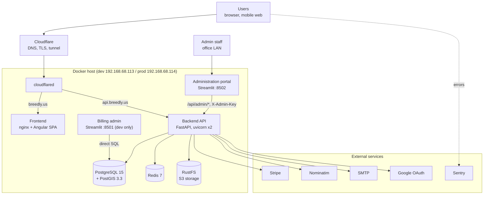
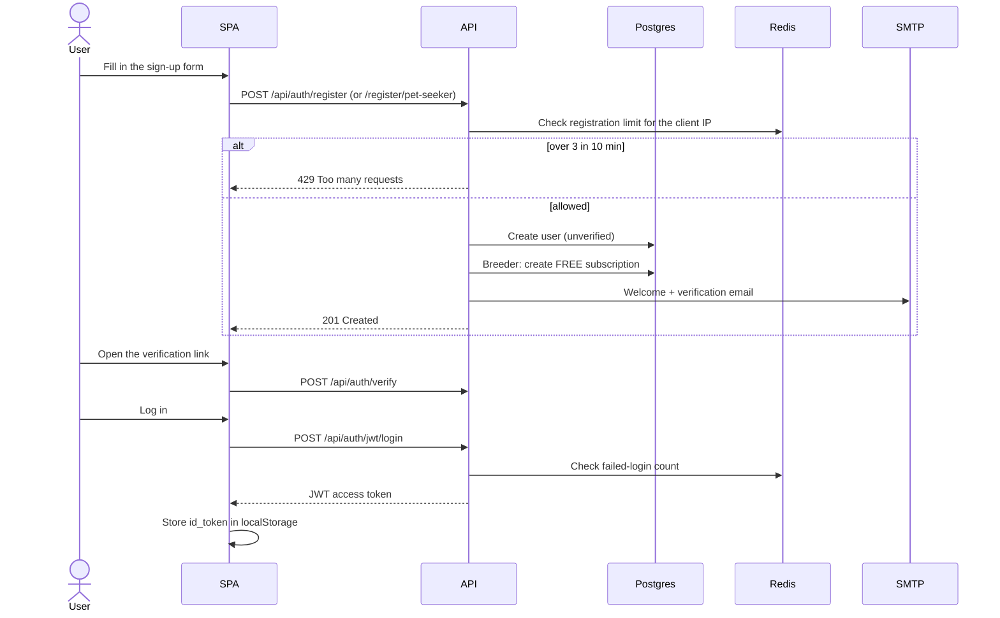
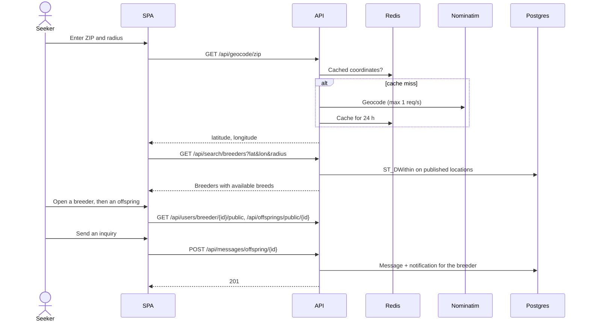
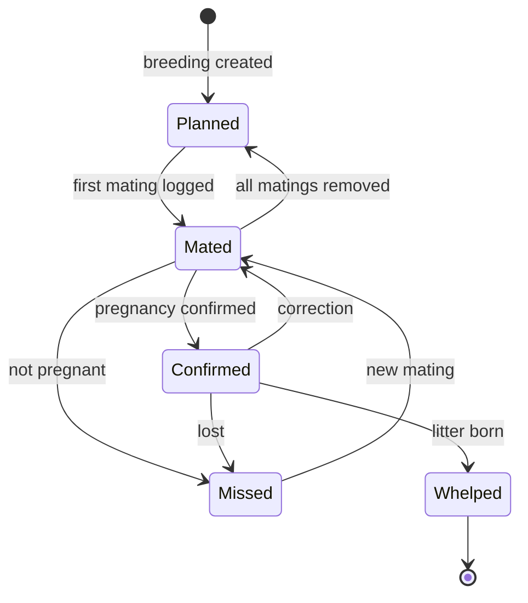
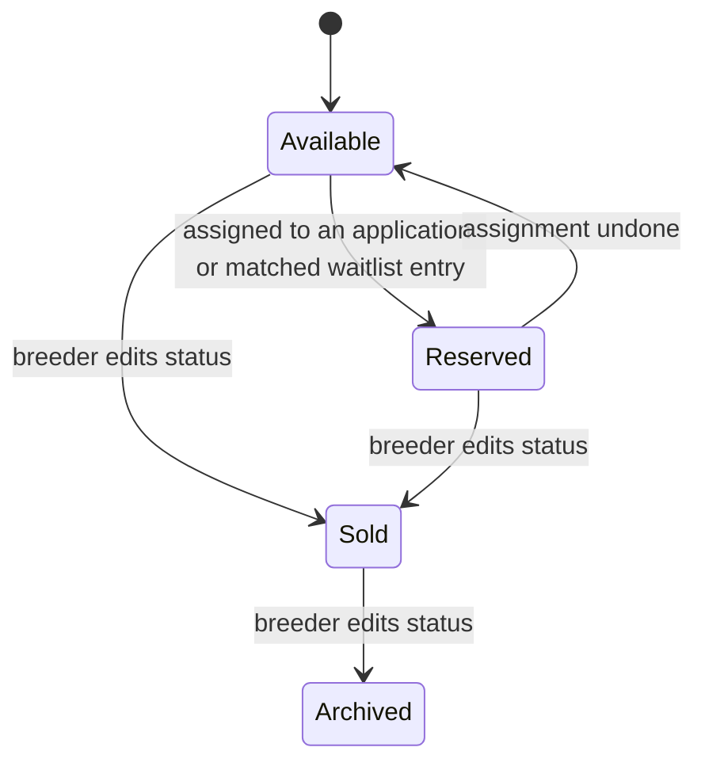
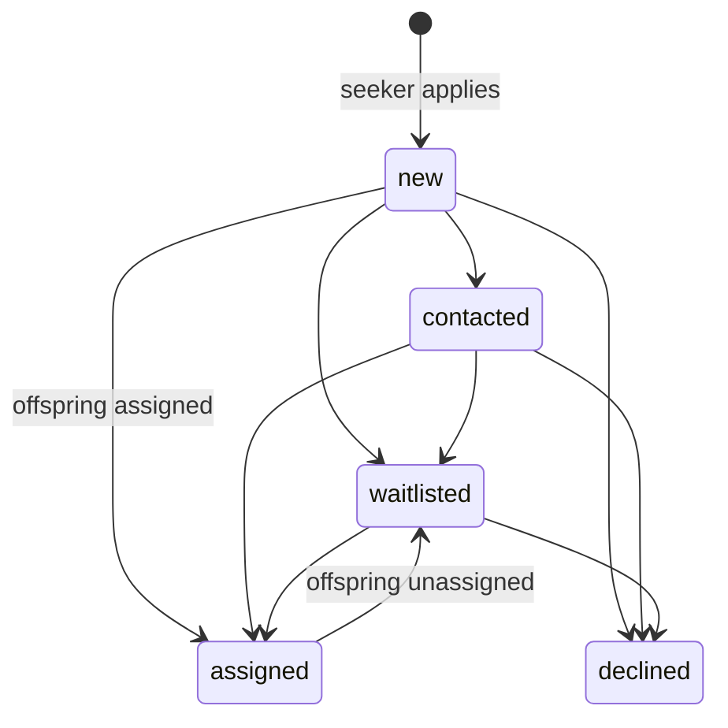
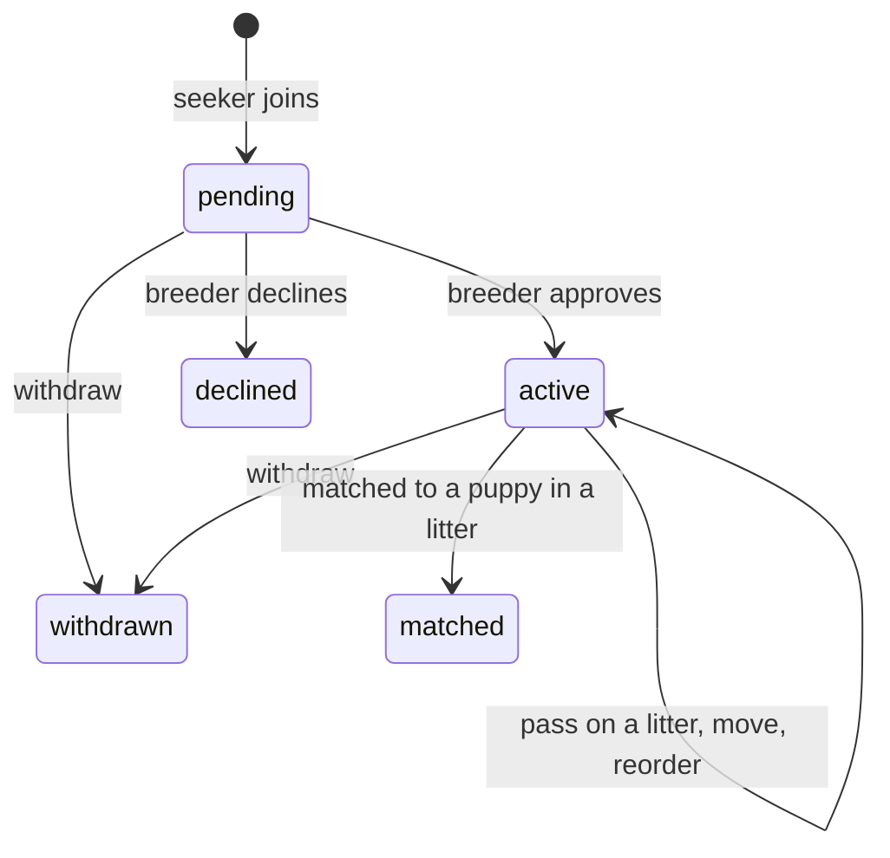
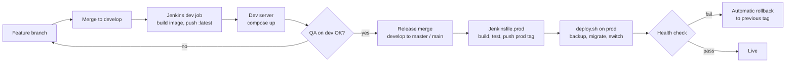
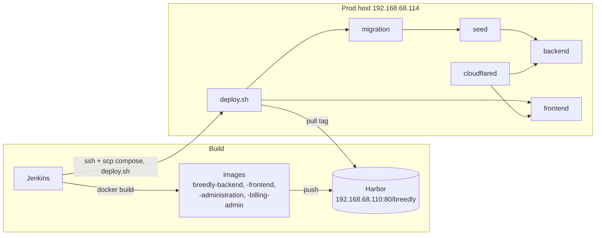

# Breedly — Software Requirements Specification

As of 2026-11-26 · reflects `develop` of `pets.backend.dev` (2509422) and `pets.frontend.dev` (2c4f542)

## 1. Introduction

Breedly is a web platform where dog and cat breeders manage pets, breedings and litters, and pet seekers find breeders on a map and contact them. This document describes what the system does, how its main workflows run, and every component needed to deploy it.

**Audience:** developers, DevOps, QA and product owners.

**Scope:** the public web app, the REST API, the two internal admin tools, and the dev and production environments. Native mobile apps are out of scope; the mobile web layout is in scope.

### 1.1 Source repositories

| Repository | Contents | Integration branch | Production branch |
| --- | --- | --- | --- |
| `pets.backend.dev` | FastAPI API (`fastapi-backend/`), Streamlit billing dashboard (`billing-admin/`), `deploy/Dockerfile`, compose files, Jenkins pipelines, this document | `develop` | `master` |
| `pets.frontend.dev` | Angular 21 SPA, nginx image, Jenkins pipelines | `develop` | `main` |
| `breedly-administration` | Streamlit admin and statistics portal | `main` | `main` |

### 1.2 Definitions

| Term | Meaning |
| --- | --- |
| Breeder | Account that owns pets, breedings and offspring and publishes them |
| Pet seeker | Account that searches for offspring, saves favorites and messages breeders |
| Service provider | Account offering pet services (groomer, trainer); behind a feature flag |
| Breeding | A planned or completed mating of a dam and a sire; produces a litter |
| Offspring | A puppy or kitten from a breeding: Available, Reserved, Sold or Archived |
| Litter application | A seeker's application for a breeder's litter |
| Waitlist | Ordered queue of seekers for a breeder's future litters; behind a feature flag |
| SPA | Single-page application (the Angular frontend) |
| p50 / p95 | Median / 95th-percentile response time |

### 1.3 Related documents

- `fastapi-backend/docs/ENVIRONMENT_VARIABLES.md`: every backend setting
- `fastapi-backend/docs/DEPLOYMENT_CHECKLIST.md`
- `fastapi-backend/docs/MESSAGES_ARCHITECTURE.md`, `PET_SEARCH_MAP_API.md`, `LITTER_APPLICATIONS_AND_HEAT_CALENDAR.md`, `GEOCODING_SERVICE.md`
- `fastapi-backend/loadtest/README.md`: load-test procedure
- `CLAUDE.md` in each repo and in the workspace root: commands and architecture notes

## 2. System overview

Breedly runs as one Docker Compose stack per environment: an Angular SPA served by nginx, a FastAPI backend, PostgreSQL with PostGIS, Redis and S3-compatible object storage. Public traffic reaches only the frontend and the API, through a Cloudflare tunnel. The admin tools are reachable only from the office LAN.

The browser loads the SPA from `breedly.us`, then calls the API at `api.breedly.us`. The backend is the only component that talks to Postgres, Redis, object storage and third parties. The one exception is the billing dashboard, which reads Postgres directly.

### 2.1 Technology stack

| Layer | Technology |
| --- | --- |
| Frontend | Angular 21 (mostly NgModule), PrimeNG 21, Angular Material, Tailwind 3, Leaflet + markercluster, `@sentry/angular` |
| Backend | Python 3.11, FastAPI, SQLAlchemy 2.0 async (asyncpg), fastapi-users (JWT), Alembic, Pydantic v2 |
| Data | PostgreSQL 15 + PostGIS 3.3, Redis 7, RustFS 1.0.6 (S3 API) |
| Admin tools | Streamlit (`breedly-administration`, `billing-admin`) |
| Delivery | Docker, Harbor registry, Jenkins, Cloudflare tunnel |

### 2.2 Backend layering

`routers/` (HTTP) → `services/` (business logic, module-level singletons) → `models/` (SQLAlchemy). Pure, DB-free rules live in `*_rules.py` (breeding planner, waitlist, litter applications) and are unit-tested on their own. Request and response models live in `schemas/`.

## 3. User roles and permissions

| Role | How it is identified | Can do |
| --- | --- | --- |
| Anonymous visitor | No token | Map search, breeder profiles, offspring pages, breed list, legal pages, register, log in |
| Pet seeker | `account_type = pet_seeker` | Everything a visitor can, plus favorites, messages, litter applications, waitlists (flag), reviews |
| Breeder | `is_breeder = true`, `account_type = breeder` | Pets, breedings and planner, offspring, litters, heat cycles, calendar, genealogy, locations, applications, waitlist (flag), CSV import, data export, billing (flag) |
| Service provider | `account_type = service_provider` | Service listings and categories; whole role behind `ENABLE_SERVICE_PROVIDERS` |
| Admin | `X-Admin-Key` header from the LAN | Statistics, user suspend/unsuspend, breed management through `/api/admin/*` |

**Enforcement:**
- Backend: fastapi-users dependencies `current_active_user`, `optional_current_user`, `current_superuser` and role guards `require_breeder`, `require_pet_seeker`, `require_service_provider`. Plan limits come from `check_pet_limit`, `check_location_limit`, `check_offspring_limit`.
- Frontend: route guards `AuthGuard`, `BreederGuard`, `PetSeekerGuard`, `ServiceProviderGuard`, plus flag guards `WaitlistGuard` and `BillingGuard`. A flag guard runs before the role guard.
- Admin API: `app/admin_auth.py`. It requires `X-Admin-Key`, and it answers 404 to any request that carries `CF-Connecting-IP`. A request from the internet therefore never reaches it, even with the key.

## 4. Functional requirements

Each requirement is testable. **[flag]** marks a feature hidden behind a build-time feature flag (section 10).

### 4.1 Accounts and authentication
- FR-AUTH-1: Register as a breeder, pet seeker, or service provider [flag]. Registration is limited to 3 per 10 minutes per client IP.
- FR-AUTH-2: Log in with email and password (JWT bearer, `/api/auth/jwt/login`). Repeated login failures from one IP are throttled.
- FR-AUTH-3: Sign in with Google OAuth; a Google-verified email marks the account verified.
- FR-AUTH-4: Email verification and password reset by emailed token.
- FR-AUTH-5: A guest who messaged a breeder can turn the conversation into an account (`/register/from-message`).
- FR-AUTH-6: A breeder can convert a seeker account to a breeder account.
- FR-AUTH-7: Instant mobile sign-in: a signed-in desktop session shows a QR code that signs the phone in (`/api/auth/mobile-signin`).
- FR-AUTH-8: Rate limits are shared across all API workers through Redis. If Redis is unavailable they fall back to per-process memory.

### 4.2 Profiles and locations
- FR-PROF-1: Breeders maintain a breedery profile: name, description, profile image and search tags.
- FR-PROF-2: Breeders manage locations. Each location has a PostGIS point used by map search, and can be published or hidden.
- FR-PROF-3: Users manage notification preferences per notification type.
- FR-PROF-4: Users can export their data as a ZIP. Exports are stored outside the public storage tree and swept after expiry.

### 4.3 Pets
- FR-PET-1: Breeders create, edit and delete pets with breed, colour, gender, birth date, location and images.
- FR-PET-2: Pet images go to object storage; documents (pedigrees, health tests) are private and served by signed download.
- FR-PET-3: Bulk import of pets from CSV, with a validation wizard in the UI.
- FR-PET-4: Genealogy view of a pet's ancestors.
- FR-PET-5: Heat cycles per dam, shown on a breeding calendar.

### 4.4 Breedings and planner
- FR-BRD-1: A breeding links a dam and a sire and moves through the stages in workflow 5.3.
- FR-BRD-2: Logging a mating gives a due date: gestation is 63 days for dogs and 65 for cats, counted from mating or ovulation.
- FR-BRD-3: The planner creates milestones (ultrasound, X-ray, whelping box, temperature, due date) with reminder dates. A background loop sends reminders for Mated and Confirmed breedings.
- FR-BRD-4: Progesterone tests can be recorded to estimate ovulation.
- FR-BRD-5: Marking the litter as born sets the stage to Whelped.
- FR-BRD-6: A breeder can attach an application form to a breeding.

### 4.5 Offspring and litters
- FR-OFF-1: Breeders add offspring to a breeding, with images, price and status Available, Reserved, Sold or Archived.
- FR-OFF-2: Public offspring pages (`/offspring/:id`) and a breeder's public listing (`/breeder/:id/offsprings`) need no login.
- FR-OFF-3: Reserving an offspring for an applicant updates the application and the offspring status together.

### 4.6 Search
- FR-SRCH-1: Map search: geocode a ZIP code (Nominatim, cached in Redis for 24 h), then find breeders within a radius of up to 100 miles (`ST_DWithin`), optionally by breed or animal kind.
- FR-SRCH-2: Offspring search grouped by breeder.
- FR-SRCH-3: Breed list and breed autocomplete. The breed list is read-only and cached for 5 minutes.

### 4.7 Messaging and notifications
- FR-MSG-1: A seeker or guest can message a breeder about an offspring. A thread view, an unread count and replies are available.
- FR-MSG-2: In-app notifications for messages, favorites, applications and planner reminders, with an unread count.
- FR-MSG-3: Email notifications through SMTP, as allowed by each user's preferences.

### 4.8 Favorites and reviews
- FR-FAV-1: Seekers save offspring as favorites; the breeder is notified.
- FR-REV-1: Seekers review breeders; reviews are rate-limited; a breeder's public profile shows the review summary.

### 4.9 Litter applications
- FR-APP-1: Seekers apply to a breeding. Statuses are `new`, `contacted`, `waitlisted`, `assigned` and `declined` (workflow 5.5).
- FR-APP-2: Breeders change statuses by hand, or assign an offspring, which sets `assigned`.

### 4.10 Waitlist [flag `ENABLE_WAITLIST`]
- FR-WL-1: Seekers join a breeder's waitlist; breeders accept, decline, reorder and match entries to litters.
- FR-WL-2: Optional deposits are tracked: `none`, `requested`, `received`, `applied`, `refunded`, `forfeited`.

### 4.11 Billing [flag `ENABLE_BILLING`]
- FR-BILL-1: Breeders subscribe to plans through Stripe; FREE is the default plan.
- FR-BILL-2: Plan limits cap pets, locations and active offspring.
- FR-BILL-3: Invoices are generated by `scripts/run_invoice_job.py`. Billing actions are written to an audit log, and sensitive columns are encrypted (`BILLING_ENCRYPTION_KEY`).
- FR-BILL-4: With the flag off, every `/api/billing/*` route except the Stripe webhook returns 404, and no plan limit is enforced.

### 4.12 Service providers [flag `ENABLE_SERVICE_PROVIDERS`]
- FR-SVC-1: Providers manage service listings in seeded categories; seekers search services and view provider profiles.

### 4.13 Administration
- FR-ADM-1: The administration portal shows usage statistics (`/api/admin/stats/*`): signups, breeds popularity and activity.
- FR-ADM-2: Admins suspend and unsuspend users (`/api/admin/users`).
- FR-ADM-3: Admins create, edit, delete and bulk-import breeds (`/api/admin/stats/breeds`). Public breed write endpoints do not exist.
- FR-ADM-4: The billing dashboard (dev only) shows subscriptions and invoices straight from the database, behind `ADMIN_PASSWORD`.

## 5. Key workflows

### 5.1 Registration and sign-in

### 5.2 From map search to an inquiry

### 5.3 Breeding lifecycle

While a breeding is Mated or Confirmed, the reminder loop sends milestone notifications. The loop claims each milestone with an atomic `UPDATE … WHERE reminded_at IS NULL`, so several workers never send the same reminder twice.

### 5.4 Offspring status

Reservation is one conditional `UPDATE … WHERE status = 'Available'` that also checks no one else holds the puppy (`services/offspring_reservation.py`), so two families can never get the same puppy. Breeders can also set any status by hand.

### 5.5 Litter application

### 5.6 Waitlist entry [flag]

Allowed actions per status are in `services/waitlist_rules.py` (`_ALLOWED`). Deposits can be recorded on pending and active entries, and settled as refunded or forfeited after a withdrawal.

### 5.7 Release flow

## 6. Data model

PostgreSQL holds all data; most main entities have UUID keys, some (breeds, breedings) integer keys. All foreign keys to `users` are `ON DELETE CASCADE` or `SET NULL`.

```mermaid
erDiagram
    USER ||--o{ LOCATION : owns
    USER ||--o{ PET : owns
    USER ||--o{ BREEDING : plans
    USER ||--o{ OFFSPRING : lists
    USER ||--o{ MESSAGE : "sends / receives"
    USER ||--o{ NOTIFICATION : receives
    USER ||--o{ OFFSPRING_FAVORITE : saves
    USER ||--o| NOTIFICATION_PREFERENCE : has
    USER ||--o{ SUBSCRIPTION : has
    USER ||--o{ BREEDER_REVIEW : "writes / receives"
    USER }o--o{ SERVICE_CATEGORY : offers
    USER ||--o{ SERVICE : provides
    BREED ||--o{ PET : classifies
    BREED ||--o{ BREED_COLOUR : has
    BREED ||--o{ OFFSPRING : classifies
    LOCATION ||--o{ PET : houses
    PET ||--o{ PET_IMAGE : has
    PET ||--o{ HEAT_CYCLE : has
    PET ||--o{ DOCUMENT : has
    BREEDING ||--o{ BREEDING_PET : "dam and sire"
    PET ||--o{ BREEDING_PET : "takes part"
    BREEDING ||--o{ BREEDING_MATING : records
    BREEDING ||--o{ BREEDING_MILESTONE : schedules
    BREEDING ||--o{ BREEDING_PROGESTERONE_TEST : records
    BREEDING ||--o| BREEDING_APPLICATION_FORM : has
    BREEDING ||--o{ LITTER_APPLICATION : receives
    BREEDING ||--o{ OFFSPRING : produces
    OFFSPRING ||--o{ OFFSPRING_IMAGE : has
    OFFSPRING ||--o{ OFFSPRING_FAVORITE : "saved in"
    PLAN ||--o{ SUBSCRIPTION : defines
    SUBSCRIPTION ||--o{ INVOICE : bills
    USER ||--o{ WAITLIST_ENTRY : "joins / owns"
    WAITLIST_ENTRY ||--o{ WAITLIST_EVENT : logs
```

**Loading rule:** `User` and `Breed` collections (`pets`, `messages`, `notifications` and so on) are lazy, and code loads them explicitly with `selectinload()`. Eager loading on these collections made every user or breed load pull the whole account history. It capped the API at about 20 requests per second (section 8).

**Migrations:** Alembic (async). Run `alembic heads` before adding a revision; register new models in `app/models/__init__.py`.

## 7. External interfaces

### 7.1 REST API

Base URL: `https://api.breedly.us` (prod), `https://api-dev.breedly.us` (dev), `http://breedly.com:8000` (local). OpenAPI docs at `/api/docs`. Errors are always `{"detail": ..., "error_code": ...}`.

| Group | Prefix | Endpoints | Auth |
| --- | --- | ---: | --- |
| Auth | `/api/auth`, `/api/auth/mobile-signin` | 14 | public / JWT |
| Users and profiles | `/api/users` | 7 | JWT, public profile |
| Pets, import | `/api/pets` | 13 | breeder |
| Breeds | `/api/breeds` | 3 (read only) | public |
| Breedings, planner | `/api/breedings` | 22 | breeder |
| Heat cycles | `/api/...heat-cycles` | 9 | breeder |
| Litter applications | `/api/...applications` | 8 | seeker / breeder |
| Offspring | `/api/offsprings` | 17 | breeder, public views |
| Locations | `/api/locations` | 7 | breeder |
| Search, geocoding | `/api/search`, `/api/geocode` | 4 | public |
| Messages | `/api/messages` | 13 | JWT, guest send |
| Notifications, preferences | `/api/notifications`, `/api/notification-preferences` | 8 | JWT |
| Favorites | `/api/favorites` | 4 | seeker |
| Reviews | `/api/reviews` | 5 | seeker, public summary |
| Waitlist | `/api/waitlist` | 20 | flag + role |
| Billing | `/api/billing` | 10 | flag + breeder; webhook signed |
| Services, categories | `/api/services`, `/api/service-categories` | 11 | flag + provider |
| Documents, exports, genealogy, support | `/api/documents`, `/api/exports`, `/api/genealogy`, `/api/support` | 9 | JWT |
| Admin | `/api/admin/stats`, `/api/admin/users` | 20 | `X-Admin-Key`, LAN only |
| Health | `/health` | 1 | public |

The frontend and the backend share no generated client. `breedly-administration/api_client.py` is the only consumer of the admin API, and nothing tests that contract. Change both in the same release.

### 7.2 Third-party services

| Service | Used for | Configured by |
| --- | --- | --- |
| Cloudflare | DNS, TLS, tunnel to the hosts, real client IP (`CF-Connecting-IP`) | Cloudflare account, `cloudflared` on each host |
| Stripe | Subscriptions and payments [flag] | `STRIPE_API_KEY`, `STRIPE_WEBHOOK_SECRET` |
| Nominatim (OpenStreetMap) | ZIP and reverse geocoding, max 1 request/s, cached 24 h | `NOMINATIM_URL`, `GEOCODING_*` |
| SMTP provider | Welcome, verification, reset, notification emails | `SMTP_*` |
| Google OAuth | Sign in with Google | `GOOGLE_OAUTH_CLIENT_ID`, `GOOGLE_OAUTH_CLIENT_SECRET`, `GOOGLE_OAUTH_REDIRECT_URI` |
| Sentry | Frontend error reporting | `environment.sentryDsn` |
| Harbor (`192.168.68.110:80`, its own host) | Private Docker registry | Jenkins credentials `harbor-username`, `harbor-password` |

## 8. Non-functional requirements

### 8.1 Performance

Targets, measured on dev with Locust (`fastapi-backend/loadtest/`) on 2026-11-26, 2 uvicorn workers:

| Requirement | Target | Measured |
| --- | --- | --- |
| NFR-PERF-1: concurrent active users at p95 ≤ 300 ms (mixed traffic) | ≥ 300 | 400 users: p95 215 ms, 0 errors |
| NFR-PERF-2: throughput without errors | ≥ 150 req/s | 159 req/s mixed, 205 req/s anonymous |
| NFR-PERF-3: breed list response | ≤ 200 ms | 150 ms, cached |
| NFR-PERF-4: no 5xx under expected peak | 0% | 0% up to 400 users; 502s start between 400 and 600 |

Before the 2026-11-26 fixes the same server handled about 50 users, with p95 above 2 s at 100 users. Login is the slowest call (p95 up to 4 s while load ramps up) because password hashing is CPU-bound.

### 8.2 Security
- NFR-SEC-1: All public traffic is TLS and enters through the Cloudflare tunnel. Production containers bind to `127.0.0.1` only, except the admin portal, which binds to the LAN address.
- NFR-SEC-2: The admin API is unreachable from the internet (404 on `CF-Connecting-IP`), and the key is compared in constant time.
- NFR-SEC-3: Rate limits use the real client IP from `CLIENT_IP_HEADER`, never a client-supplied `X-Forwarded-For`.
- NFR-SEC-4: Private documents and exports are never under the public storage path.
- NFR-SEC-5: Billing secrets are encrypted at rest. The Stripe webhook verifies its signature.
- NFR-SEC-6: The frontend sends security headers (`deploy/security-headers.conf`) and redirects `www` to the apex domain.

### 8.3 Availability and recovery
- NFR-AV-1: Every production backend deploy takes a `pg_dump` and a storage backup first.
- NFR-AV-2: A deploy that fails its health check rolls back to the previous image tag automatically.
- NFR-AV-3: Containers restart `unless-stopped`; Docker health checks hit `/health`.

### 8.4 Usability
- NFR-UX-1: Every page works at 390 px wide with no horizontal scroll. Touch targets are at least 44 px.
- NFR-UX-2: Breeders get a bottom tab bar on mobile. The mobile header menu shows the account inline with Log out.

## 9. Deployment components

### 9.1 Environments

| | Dev | Production |
| --- | --- | --- |
| Host | `192.168.68.113` | `192.168.68.114` (prod-docker) |
| CPU / RAM / swap | 4 cores, 3 GiB, 512 MiB | 4 cores, 4 GiB, 1 GiB |
| Web | `https://dev.breedly.us` | `https://breedly.us` (+ `www` redirect) |
| API | `https://api-dev.breedly.us` | `https://api.breedly.us` |
| Source branches | backend `develop`, frontend `develop` | backend `master`, frontend `main` |
| Pipeline | `Jenkinsfile` | `Jenkinsfile.prod` |
| Image tags | `:latest` | immutable `prod-<build>-<sha>`, kept in `releases.env` |
| App directory | `/home/breedly/breedly-app/` | `/home/breedly/breedly-app/` |
| Compose file | `delivery/docker-compose.yml` | `delivery/docker-compose.prod.yml` |

### 9.2 Containers

| Service | Image | Dev port | Prod port | Persistent data | Role |
| --- | --- | --- | --- | --- | --- |
| `postgres` | `postgis/postgis:15-3.3-alpine` | `127.0.0.1:5432` | internal | `postgres_data` | Main database |
| `redis` | `redis:7-alpine` (AOF on) | internal | internal | `redis_data` | Geocode cache, shared rate limits |
| `rustfs` | `rustfs/rustfs:1.0.6` | internal | internal | `rustfs_data` | S3 object storage for photos and documents |
| `migration` | `breedly-backend` | — | — | — | One-shot `alembic upgrade head` |
| `seed` | `breedly-backend` | — | — | — | One-shot `db/seed_breeds.py` + `scripts/seed_service_categories.py` |
| `backend` | `breedly-backend` | `8000` | `127.0.0.1:8000` | `backend_storage`, `backend_exports` | FastAPI API |
| `frontend` | `breedly-frontend` | `4200 → 80` | `127.0.0.1:8080 → 80` | — | nginx serving the SPA |
| `administration` | `breedly-administration` | `8502 → 8501` | `192.168.68.114:8502 → 8501` | — | Admin portal, LAN only |
| `billing-admin` | `breedly-billing-admin` | `8501` | not deployed | — | Billing dashboard, direct DB access |
| `cloudflared` | host service, not in compose | — | — | — | Tunnel from Cloudflare to the loopback ports |

Start order: `postgres`, `redis` and `rustfs` → `migration` (must succeed) → `seed` → `backend` → `frontend`.

### 9.3 Build pipelines

| Pipeline | Trigger branch | Steps |
| --- | --- | --- |
| Backend `Jenkinsfile` | `develop` | Build image → push `:latest` to Harbor → copy `docker-compose.yml` + `.env` to dev → `docker compose up -d` |
| Backend `Jenkinsfile.prod` | `master` | Build image (`linux/amd64`) → `deploy/ci/backend-tests.sh` (single Alembic head, migrations on an empty DB, pytest) → push `prod-<build>-<sha>` → `deploy.sh backend <tag>` → smoke test |
| Frontend `Jenkinsfile` | `develop` | Build (`production` config = dev API) → push → deploy to dev |
| Frontend `Jenkinsfile.prod` | `main` | Unit tests → `prod` build (`NG_CONFIG=prod`) → push → `deploy.sh frontend <tag>` with health check |
| `billing-admin/Jenkinsfile` | backend repo | Build and redeploy only the billing dashboard on dev |
| Administration portal | — | `breedly-administration` has no Jenkinsfile. Prod runs `deploy.sh administration <tag>` with an image from Harbor; how that image is built is not documented (section 12) |

**Shared compose file on dev:** the backend, frontend and billing-admin dev jobs each copy their own `delivery/docker-compose.yml` to the same path on the dev server, so the last job to run wins. Keep the backend and frontend copies identical; the backend copy is the reference.

### 9.4 Hardware and capacity

Both hosts have 4 CPU cores (dev 3 GiB RAM, prod 4 GiB), recorded on 2026-11-26. The Harbor registry runs on a separate host, `192.168.68.110`.

The dev host handles about 400 active users with 2 workers (section 8.1). The 502 errors at about 600 users were not caused by memory: swap stayed almost unused and the container never restarted. They most likely came from 2 workers saturating 2 of the 4 cores. Each worker opens up to 15 Postgres connections (`DB_POOL_SIZE` 5 + `DB_MAX_OVERFLOW` 10). So 4 workers would use up to 60 of Postgres's default 100. After the 2026-11-26 release, prod idled at 8 connections.

**Next capacity step:** set `WEB_CONCURRENCY=4` in compose on both hosts, then re-run the load test with live `docker stats` capture.

### 9.5 Local development

`./dev.sh` in the workspace root starts Postgres and Redis only, creates a Python 3.11 venv with `uv`, runs migrations and seeds into `breedly_dev`, then serves the backend on `:8000`, the frontend on `:4200` and, with `--admin`, the admin portal on `:8501`. Open `http://breedly.com:4200`, which needs `127.0.0.1 breedly.com` in `/etc/hosts`. Never point it at `test_db`: the test suite drops that database's tables.

## 10. Configuration

### 10.1 Feature flags (must match across repos)

| Backend env var | Frontend `environment.*` | Default | Effect when off |
| --- | --- | --- | --- |
| `ENABLE_SERVICE_PROVIDERS` | `enableServiceProviders` | off | Provider sign-up, routes and APIs hidden |
| `ENABLE_WAITLIST` | `enableWaitlist` | off | `/api/waitlist` returns 404, waitlist UI hidden |
| `ENABLE_BILLING` | `enableBilling` | off | `/api/billing/*` returns 404 (webhook excepted), no plan limits, pricing hidden |

Frontend flags are fixed at build time in `src/environments/*.ts`. Changing a flag means a backend config change and a frontend rebuild. Production values live in `delivery/docker-compose.prod.yml` and `environment.prod.ts`.

### 10.2 Backend environment variables

Full list with defaults: `fastapi-backend/docs/ENVIRONMENT_VARIABLES.md` and `app/config.py`.

| Group | Variables |
| --- | --- |
| Core | `DATABASE_URL` (asyncpg), `SECRET_KEY` (≥ 32 chars), `JWT_LIFETIME_SECONDS`, `ENVIRONMENT`, `DEBUG`, `ALLOWED_ORIGINS`, `FRONTEND_URL` |
| Performance | `WEB_CONCURRENCY` (default 2, set in the Dockerfile), `DB_POOL_SIZE` (5), `DB_MAX_OVERFLOW` (10), `DB_POOL_TIMEOUT` (30) |
| Networking | `CLIENT_IP_HEADER` (`CF-Connecting-IP`), `TRUSTED_PROXY_HOPS`, `HOST`, `PORT` |
| Cache | `REDIS_URL` |
| Storage | `STORAGE_PATH`, `STORAGE_URL`, `EXPORT_PATH`, `OBJECT_STORAGE`, `S3_ENDPOINT_URL`, `S3_ACCESS_KEY`, `S3_SECRET_KEY` |
| Images | `MAX_IMAGE_SIZE_MB`, `ALLOWED_IMAGE_TYPES`, `IMAGE_MAX_WIDTH`, `IMAGE_MAX_HEIGHT`, `IMAGE_QUALITY` |
| Geocoding | `NOMINATIM_URL`, `GEOCODING_USER_AGENT`, `GEOCODING_RATE_LIMIT`, `GEOCODING_CACHE_TTL` |
| Email | `SMTP_HOST`, `SMTP_PORT`, `SMTP_USER`, `SMTP_PASSWORD`, `SMTP_FROM_EMAIL`, `SMTP_FROM_NAME`, `SMTP_TLS` |
| OAuth | `GOOGLE_OAUTH_CLIENT_ID`, `GOOGLE_OAUTH_CLIENT_SECRET`, `GOOGLE_OAUTH_REDIRECT_URI` |
| Billing | `STRIPE_API_KEY`, `STRIPE_WEBHOOK_SECRET`, `BILLING_ENCRYPTION_KEY` |
| Admin | `ADMIN_API_KEY` (must equal the admin portal's key), `ADMIN_PASSWORD` (billing dashboard) |
| Planner | `PLANNER_REMINDERS_ENABLED`, `PLANNER_REMINDER_INTERVAL_SECONDS` |
| Flags | `ENABLE_SERVICE_PROVIDERS`, `ENABLE_WAITLIST`, `ENABLE_BILLING` |

### 10.3 Frontend environments

| File | Build config | API |
| --- | --- | --- |
| `environment.ts` | `production` (default build) | `https://api-dev.breedly.us` (dev server) |
| `environment.prod.ts` | `prod` | `https://api.breedly.us` |
| `environment.development.ts` | `ng serve` | `http://breedly.com:8000` |
| `environment.waitlist.ts` | local and e2e only | local, waitlist on |

## 11. Operations

### 11.1 Release process
1. Merge feature branches into `develop`; Jenkins deploys dev.
2. Check the change on dev (`docs/qa/` in the frontend holds the manual QA scripts).
3. Merge `develop` into `master` (backend) and `main` (frontend) with a commit named `Release: merge develop into … (
)`.
4. Run the prod pipelines: backend first, then frontend.
5. Check `https://api.breedly.us/health` and the changed pages.

### 11.2 Rollback
- `./deploy.sh rollback backend|frontend|administration` on the prod host restores the previous tag from `releases.env`.
- The database is never rolled back automatically. A failed migration changes nothing, because Alembic runs in one transaction. A successful migration followed by a broken app is restored by hand from the dump path that `deploy.sh` prints.

### 11.3 Monitoring
- Docker health checks on `/health`; it also reports object-storage status.
- Frontend errors go to Sentry.
- Usage statistics live in the administration portal.
- Open item: no server metrics or alerting (CPU, memory, 5xx rate) are set up.

### 11.4 Load testing
Follow `fastapi-backend/loadtest/README.md`. On shared servers, create test accounts with `loadtest/seed_users_db.py` (no emails) and delete them afterwards with `--cleanup`. Use read-only scenarios: favorites and messages notify real breeders. Never run a load test against production.

## 12. Known issues and open items

| Item | Impact | Next step |
| --- | --- | --- |
| 502 errors from about 600 concurrent users on dev | Capacity ceiling | Try `WEB_CONCURRENCY=4` (4 cores) and re-run the load test with `docker stats` captured live; the original container's logs were lost on redeploy |
| Login p95 up to 4 s under load | Slow sign-in at peaks | Review the password-hash cost; consider a separate worker pool |
| `GET /api/offsprings/public/{id}` p95 1.1 s at 600 users | Slowest public page | Profile its queries |
| 6 failing tests in `e2e/service-account-mobile.spec.ts` (frontend) | Red e2e run | Fix or gate them behind the service-provider flag |
| No metrics or alerting | Outages noticed late | Add host and container monitoring |
| Admin API contract untested | Admin portal can break silently | Add contract tests for `api_client.py` |
| Divergent dev compose copies across repos | Last deploy wins | Keep one source of truth |
| Build of the `breedly-administration` image not documented | Admin portal releases depend on tribal knowledge | Add a Jenkinsfile or document the manual build |
